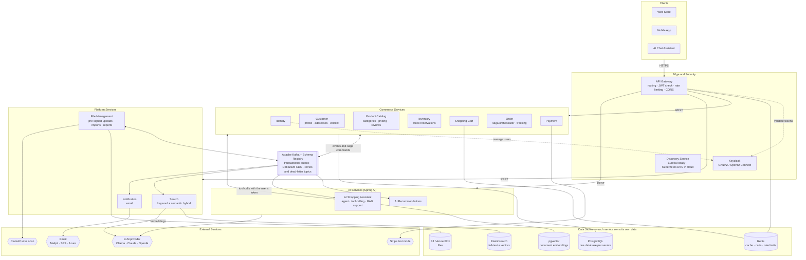
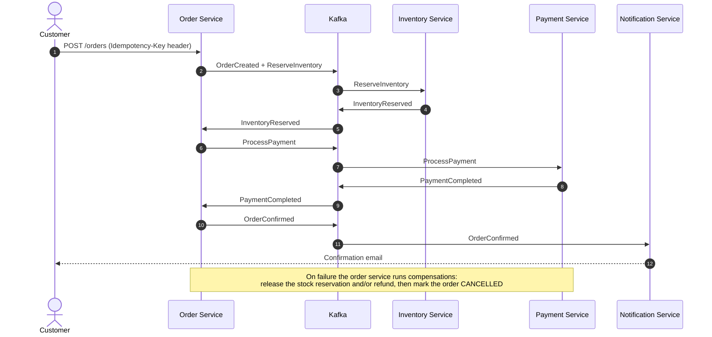

# AI-Powered Enterprise E-Commerce Platform

A production-grade, event-driven e-commerce platform: Java 21 · Spring Boot 4 · Spring Cloud · Spring AI · Kafka ·
PostgreSQL/pgvector · Elasticsearch · Redis · Keycloak · Docker/Kubernetes · AWS & Azure.

> **Status:** Phase 1 (architecture & planning). Folder skeleton only — no code yet.

## Architecture

**How the services talk:** the client waits for an answer → REST through the gateway.
Multi-step or background work → Kafka events. This covers the order saga, updating the search index,
emails, recommendations and file processing.

**Cross-cutting:** OpenTelemetry tracing · Prometheus + Grafana · centralized logs (ELK/OpenSearch) ·
Docker Compose locally · Kubernetes + Helm · GitHub Actions CI/CD · Terraform on AWS (primary) and Azure.

### Checkout flow (order saga)

Full details: [docs/DEVELOPMENT_ROADMAP.md](docs/DEVELOPMENT_ROADMAP.md).
The image in `docs/architecture/diagrams/aiecommerce-architecture-reference.jpeg` was the original inspiration only.
It is not this project's architecture: it shows Pinecone, Snowflake, Kubeflow and Feast, which this project does not use.

## Start here

| Document | Purpose |
|---|---|
| [docs/PROJECT_STRUCTURE.md](docs/PROJECT_STRUCTURE.md) | Repository layout and per-service package structure |
| [docs/DEVELOPMENT_ROADMAP.md](docs/DEVELOPMENT_ROADMAP.md) | Architecture summary, tech choices, 18-phase roadmap, decisions awaiting approval |
| [docs/PHASE_TASKS.md](docs/PHASE_TASKS.md) | Every task per phase: what, how, and done-when criteria |
