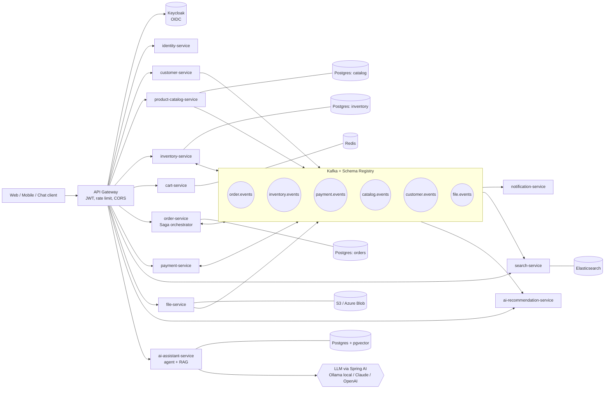
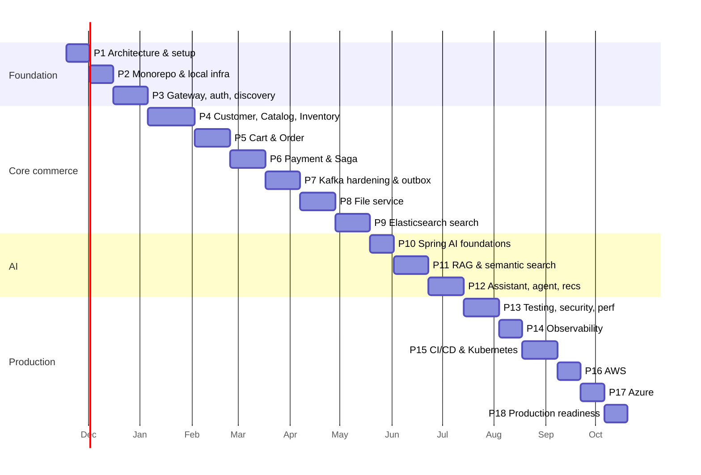

# Development Roadmap — AI-Powered Enterprise E-Commerce Platform

> Companion docs: [PROJECT_STRUCTURE.md](PROJECT_STRUCTURE.md) (folders) · [PHASE_TASKS.md](PHASE_TASKS.md) (every task, with how-to)
>
> Status: **Phase 1 in progress.** Nothing beyond the folder skeleton exists yet.

---

## 1. Starting point (inspected 2026-11-17)

| Item | Found | Needed | Action |
|---|---|---|---|
| Repository | Empty except a reference architecture image | — | Skeleton created |
| Java | 17.0.15 | **21 LTS** (or 25 LTS) | Install Temurin 21 via SDKMAN (`sdk install java 21-tem`) |
| Maven | 3.9.11 | 3.9.x | OK — we will also add the Maven Wrapper (`mvnw`) |
| Docker | **not installed** | Docker Desktop / Colima / OrbStack | Required before Phase 2 |
| kubectl / kind / Helm | not installed | Phase 15 | Install later |
| Terraform, AWS CLI, Azure CLI | not checked | Phases 16–17 | Install later |
| Node | 22.23.1 | only for optional tooling (k6 is a Go binary) | OK |

**Machine sizing note:** the full stack (Postgres, Kafka, Schema Registry, Redis, Elasticsearch, Keycloak,
Prometheus, Grafana, OpenSearch/ELK, 14 services) needs ~12–16 GB RAM for Docker. We will use Compose
**profiles** so you only run what the current phase needs.

---

## 2. Target architecture (summary)

### Sync vs async communication

| Interaction | Style | Why |
|---|---|---|
| Client → any service | REST via gateway | Request/response, user waits for answer |
| Cart → Catalog (price/availability check) | REST + cache | Needs current answer now; tolerate outage with cached price |
| Agent tools → catalog/inventory/cart/order | REST (user's token propagated) | Agent must act with the user's permissions |
| Order → Inventory → Payment → Order (saga) | **Kafka** commands/events | Long-running, must survive crashes/retries, no distributed lock |
| Catalog → Search / Recommendation index | **Kafka** (outbox + CDC) | Eventual consistency is fine; decouples write model from read model |
| Anything → Notification | **Kafka** | Fire-and-forget; email outage must not fail an order |
| File uploaded → processing (scan, import, thumbnails) | **Kafka** | Long-running async jobs |

### Service boundaries (why each exists)

| Service | Business reason for a separate boundary |
|---|---|
| api-gateway | Single entry point: auth check, routing, rate limiting, CORS — keeps cross-cutting code out of services |
| discovery-service | Dynamic service lookup locally; dropped in K8s (DNS does the job) — kept to learn both approaches |
| identity-service | Authentication changes for security reasons, not business reasons; isolates IdP integration |
| customer-service | Customer profile/preferences change independently of credentials; owns wishlist |
| product-catalog-service | Catalog is managed by merchandising/admin; read-heavy; owns reviews (reviews are about products, not worth a service) |
| inventory-service | Stock has strict concurrency/consistency needs (locking) and different scaling than catalog |
| cart-service | Very high write volume, short-lived data, Redis-centric — different data store and scaling profile |
| order-service | Core transactional workflow, owns order lifecycle and saga state |
| payment-service | PCI-sensitive boundary; idempotency and audit; isolated blast radius |
| notification-service | Channel integrations (email, later SMS/push) change independently; must never block business flow |
| search-service | Read model in Elasticsearch, separately scalable; rebuilds from events |
| file-service | Large binary handling, scanning, cloud storage SDKs — keep heavy I/O away from business services |
| ai-recommendation-service | Batch + online recommendation logic, separate cost/scaling profile (embeddings) |
| ai-assistant-service | LLM calls are slow, expensive, and need special guardrails — isolate them |

**Deliberately NOT separate services:** reviews (inside catalog), wishlist (inside customer), admin (each
service exposes `/admin/**` endpoints guarded by `ROLE_ADMIN`; reports are produced by file-service),
order tracking (inside order-service), config server (12-factor env vars + K8s ConfigMaps instead).

---

## 3. Technology selection

> Exact patch versions get pinned in Phase 1 task P1-T03 after checking the official compatibility matrices.
> The rule: Spring Boot ↔ Spring Cloud ↔ Spring AI versions must come from the same release train.

| Concern | Choice | Alternatives | Why this one |
|---|---|---|---|
| Language | Java 21 LTS (records, sealed types, virtual threads, pattern matching) | Java 25 LTS | Prompt preference, widest library support |
| Framework | Spring Boot 4.0.x | Quarkus, Micronaut | Industry standard, Spring AI/Cloud ecosystem |
| Cloud | Spring Cloud 2025.1.x (Gateway, LoadBalancer, Circuit Breaker, Eureka) | Istio service mesh | Matches Boot 4.0; mesh is heavier to learn/run |
| AI | Spring AI 2.0.x | LangChain4j | First-party Spring integration; portable `ChatClient`, `VectorStore`, tool calling |
| LLM | Ollama locally (free); Anthropic Claude / OpenAI / Azure OpenAI in cloud via config | — | Zero cost while developing, real models for evaluation |
| Build | Maven + wrapper, multi-module | Gradle | You already know Maven; the prompt asks for it |
| Mapping | MapStruct + Lombok (sparingly; records preferred for DTOs) | Manual mapping | Compile-time, no reflection |
| DB | PostgreSQL 17, Flyway, HikariCP | MySQL | JSONB, pgvector, strong locking semantics |
| Search | Elasticsearch 8.x/9.x | OpenSearch | Best-in-class full-text, facets, kNN + RRF hybrid |
| Vector store | **pgvector** for RAG docs; **ES dense_vector** for product semantic search | Pinecone, Qdrant, Weaviate | No extra infra; hybrid search in one ES query (ADR) |
| Messaging | Apache Kafka 4.x (KRaft), Avro + Confluent Schema Registry, Debezium | RabbitMQ, JSON Schema, Apicurio | Event log replay, ordering per key, ecosystem |
| Cache | Redis 7+/Valkey | Caffeine (local only) | Shared cache, rate-limit buckets, cart storage |
| Identity | Keycloak 26 (OIDC) | Spring Authorization Server, Auth0, Cognito, Entra ID | Production-grade IdP, free, runs locally |
| Resilience | Resilience4j | Spring Retry only | Circuit breaker + bulkhead + rate limiter + retry |
| Object storage | MinIO locally (S3 API) → S3; Azurite → Azure Blob | — | Free local equivalents of both clouds |
| Virus scan | ClamAV container | Cloud scanning services | Free, realistic integration |
| Email | Mailpit locally → Amazon SES / Azure Communication Services | SendGrid | Free local inbox for testing |
| Payments | Stripe test mode | Razorpay test mode, PayPal sandbox | Best docs, webhooks, idempotency keys built in |
| Testing | JUnit 5, Mockito, AssertJ, Testcontainers, Spring Cloud Contract, k6/Gatling | Pact | All JVM-native |
| Observability | Actuator, Micrometer, OpenTelemetry, Prometheus, Grafana, Tempo/Jaeger, ELK or OpenSearch | Datadog, New Relic | Free and open; same concepts as commercial tools |
| CI/CD | GitHub Actions, SonarQube/SonarCloud, Checkstyle, SpotBugs, OWASP Dependency-Check, Trivy | Jenkins, GitLab CI | Repo is on GitHub |
| Containers | Docker multi-stage, Kubernetes, Helm, kind locally | Docker Swarm | Industry standard |
| IaC | Terraform | CDK, Bicep, Pulumi | One tool for AWS and Azure; easy `destroy` |

---

## 4. Major architecture decisions & trade-offs (ADRs to write in Phase 1)

| ADR | Decision | Key trade-off |
|---|---|---|
| 0001 | Microservices, database-per-service, monorepo | Operational complexity vs independent deploy/scale (justified as a learning goal; a modular monolith would be the honest choice for a small startup — we'll discuss this) |
| 0002 | Saga **orchestration** in order-service (notification/search stay choreographed) | Central state machine is easier to reason about, test and observe; cost: orchestrator coupling. Choreography for simple fan-out side effects |
| 0003 | Transactional outbox + Debezium CDC (polling relay as fallback) | Guarantees "DB commit ⇔ event published" without 2PC; adds Kafka Connect to operate |
| 0004 | Avro + Schema Registry, BACKWARD compatibility | Strong contracts and evolution rules vs. human-readable JSON |
| 0005 | Keycloak as IdP; services are OAuth2 resource servers | Don't build password storage yourself vs. extra component to run |
| 0006 | Eureka locally, Kubernetes DNS in K8s | Learn both; profile switch keeps code identical |
| 0007 | pgvector for RAG, ES dense_vector for product hybrid search | Two vector stores vs. avoiding a third database; each lives next to its data |
| 0008 | Pre-signed URL uploads directly to object storage | App never streams large bytes; needs client-side multi-step flow |
| 0009 | LLM provider behind Spring AI abstraction, Ollama default locally | Portability and zero cost vs. lowest-common-denominator features |
| 0010 | AWS primary cloud (EKS), Azure secondary (AKS) guide | EKS reuses Helm charts; must be created on demand and destroyed to control cost |
| 0011 | Redis-backed cart with periodic Postgres persistence | Speed vs durability |
| 0012 | Kafka self-hosted via Strimzi in cloud K8s (MSK/Event Hubs documented) | Cost vs. managed operations |

---

## 5. Phase roadmap

Time estimates assume **~10–12 focused hours/week** alongside a full-time job. Total: **~42–52 weeks**.
Each phase ends with: project builds (`./mvnw verify`), tests pass, Compose stack starts, docs + gap tracker updated, a git tag `phase-NN`.

### Phase 1 — Requirements, architecture, technology decisions, setup (≈2 weeks)
- **Goal:** agree on what we build and why before writing code.
- **Deliverables:** README, ARCHITECTURE.md (all 9 Mermaid diagrams), ADR-0001…0012, DATABASE_DESIGN.md (first draft), KAFKA_EVENTS.md (event catalog draft), TECHNICAL_GAP_TRACKER.md baseline, toolchain installed.
- **Exit criteria:** you have approved the architecture & decisions in §7; Java 21 + Docker working.
- **Learn:** bounded contexts, DDD strategic design, sync vs async trade-offs, writing ADRs.

### Phase 2 — Monorepo, Maven multi-module, Docker Compose infra (≈2 weeks)
- **Goal:** a buildable skeleton and one-command local infrastructure.
- **Deliverables:** root `pom.xml` + `platform-bom`, `common-*` libs (error model, correlation ID), Maven wrapper, `.editorconfig`, Checkstyle; `docker-compose` with Postgres(+pgvector), Kafka (KRaft), Schema Registry, Kafka UI, Redis, Elasticsearch + Kibana, Keycloak, MinIO, Mailpit, ClamAV; per-service DB init scripts; `.env.example`; LOCAL_SETUP.md.
- **Exit:** `./mvnw verify` green; `docker compose --profile core up` healthy; a "hello" service connects to its DB via Flyway.
- **Learn:** Maven BOM/dependency management, Docker networking, health checks, HikariCP basics.

### Phase 3 — API Gateway, authentication, authorization, discovery (≈3 weeks)
- **Goal:** secure front door.
- **Deliverables:** discovery-service (Eureka), api-gateway (routes, JWT validation, token relay, Redis rate limiter, CORS, correlation ID), Keycloak realm (clients, roles `CUSTOMER`/`ADMIN`/`SUPPORT`, refresh-token rotation), identity-service (registration → Keycloak Admin API, `CustomerRegistered` event), `common-security` (resource server + method security), SECURITY.md draft.
- **Exit:** register → login → call a protected endpoint through gateway; 401/403 tests; rate limit returns 429.
- **Learn:** OAuth2/OIDC flows (Auth Code + PKCE, client credentials), JWT validation, RBAC, CSRF vs stateless APIs.

### Phase 4 — Customer, Product Catalog, Inventory services (≈4 weeks)
- **Goal:** the core domain with production-quality JPA.
- **Deliverables:** customer (profile, addresses, wishlist), catalog (products, categories tree, attributes JSONB, pricing, reviews & ratings, admin APIs, pagination/sorting, auditing), inventory (stock, reservations with optimistic + pessimistic locking), OpenAPI per service, Redis caching for catalog reads, seed data (100k+ products generator).
- **Exit:** CRUD + search-by-filter endpoints with tests; concurrent reservation test proves no oversell.
- **Learn:** JPA performance (N+1, fetch joins, projections), indexing, locking, auditing, cache-aside. Scenarios #1, #11, #16.

### Phase 5 — Shopping Cart & Order Management (≈3 weeks)
- **Goal:** checkout up to "order created".
- **Deliverables:** cart (Redis, guest → user merge, price re-validation via catalog REST with circuit breaker), order (create from cart, status machine, order history, tracking timeline, idempotent create via `Idempotency-Key`), first Kafka event `OrderCreated` (simple outbox).
- **Exit:** cart → order flow works; catalog down → cart uses cached price / degrades gracefully.
- **Learn:** state machines, idempotency, Resilience4j (timeouts, CB, retry, bulkhead). Scenarios #5, #6.

### Phase 6 — Payment Service & Saga (≈3 weeks)
- **Goal:** reliable distributed checkout.
- **Deliverables:** payment-service with Stripe test mode (PaymentIntent, webhooks with signature verification, refunds), saga orchestrator in order-service: `OrderCreated → ReserveInventory → InventoryReserved → ProcessPayment → PaymentCompleted → OrderConfirmed`; compensations for payment failure & stock unavailable; saga timeout handling.
- **Exit:** happy path + every failure path covered by integration tests (Testcontainers Kafka).
- **Learn:** saga orchestration vs choreography, compensating transactions, exactly-once *effects*. Scenarios #7, #12, #19.

### Phase 7 — Kafka event-driven architecture hardening & transactional outbox (≈3 weeks)
- **Goal:** turn "it works" into "it survives production".
- **Deliverables:** Avro schemas in `event-schemas` + Schema Registry, outbox via Debezium CDC (Outbox Event Router), idempotent consumers (processed-event table), retry topics + DLT with `@RetryableTopic`, DLT replay tool, partitioning by aggregate ID for ordering, consumer lag metrics, schema evolution demo (add optional field), notification-service consuming events → Mailpit email, KAFKA_EVENTS.md final.
- **Exit:** chaos tests: kill a consumer mid-batch, redeliver duplicates, poison message → DLT; no data loss, no double effects.
- **Learn:** delivery semantics, rebalancing, offsets, ordering, CDC. Scenarios #8, #9.

### Phase 8 — File Management Service & large uploads (≈3 weeks)
- **Goal:** handle big files without touching app memory.
- **Deliverables:** storage abstraction (`ObjectStorage` with S3/MinIO and Azure Blob/Azurite impls), pre-signed single + multipart upload, resumable sessions (upload state in Postgres), validation (size, MIME sniffing, extension allow-list), ClamAV scan via event, product image processing (thumbnails), bulk product CSV/Excel import (streaming, batched, error report), large Excel report generation (SXSSF streaming, async job + download link), lifecycle cleanup of abandoned uploads.
- **Exit:** 2 GB upload with constant heap; resume after interrupt; 1M-row import/report doesn't OOM.
- **Learn:** streaming I/O, pre-signed URLs, async job pattern. Scenarios #3, #4.

### Phase 9 — Elasticsearch indexing & advanced search (≈3 weeks)
- **Goal:** fast, relevant product search.
- **Deliverables:** index templates (analyzers, synonyms, edge-ngram autocomplete), consumer of catalog/inventory/price events, full reindex job with aliases (zero-downtime), faceted search (category, brand, price ranges, rating), relevance tuning (boosts, function score), sync-failure handling (DLT + reconciliation job).
- **Exit:** search p95 < 100 ms on 1M docs locally; reindex without downtime; reconciliation fixes drift.
- **Learn:** inverted index, analyzers, BM25, aliases, PostgreSQL vs ES responsibilities. Scenario #13.

### Phase 10 — AI integration foundations with Spring AI (≈2 weeks)
- **Goal:** understand LLM mechanics before building features.
- **Deliverables:** ai-assistant-service skeleton, provider-agnostic `ChatClient` config (Ollama / Anthropic / OpenAI via profile), prompt templates, structured output (records), token usage metrics & cost tracking, timeouts/retries/fallback model, AI description generator in catalog flow (draft → human approval → publish), AI_ARCHITECTURE.md draft.
- **Exit:** same feature works on Ollama and a cloud model by changing config only; token metrics in Prometheus.
- **Learn:** tokens, context windows, temperature, prompt engineering, structured outputs, cost control.

### Phase 11 — RAG customer support & semantic search (≈3 weeks)
- **Goal:** grounded answers and meaning-based search.
- **Deliverables:** document ingestion (PDF/DOCX/MD via file-service events → Tika reader → chunking → embeddings → pgvector), retrieval with metadata filters, answer with citations, "I don't know" handling with similarity threshold, product embeddings into ES `dense_vector`, hybrid search (BM25 + kNN with RRF), evaluation set (golden Q&A) with automated scoring.
- **Exit:** evaluation report: retrieval hit-rate and answer faithfulness above agreed thresholds.
- **Learn:** embeddings, chunking strategies, similarity metrics, HNSW, hybrid ranking, hallucination prevention.

### Phase 12 — AI shopping assistant, agent & recommendations (≈3 weeks)
- **Goal:** a controlled, safe AI agent.
- **Deliverables:** tools (`searchProducts`, `compareProducts`, `checkStock`, `addToCart`, `getOrderStatus`, `placeOrder` **requires explicit confirmation**), user-token propagation so tools respect RBAC, conversation memory (Postgres), prompt-injection defenses (input/output guards, tool allow-lists, no secrets in context), ai-recommendation-service (co-purchase + embedding similarity + "why recommended" explanation), AI observability (traces per tool call, token cost per conversation).
- **Exit:** red-team test suite (injection attempts) passes; agent cannot act beyond the user's permissions.
- **Learn:** agent loops, tool design, guardrails, evaluation, AI security.

### Phase 13 — Automated testing, security hardening, performance testing (≈3 weeks)
- **Goal:** confidence and safety.
- **Deliverables:** coverage gaps closed, consumer-driven contracts between services, E2E journey tests, k6/Gatling scenarios (browse, search, checkout spike), OWASP Top 10 review, input validation audit, security headers, audit logging, mTLS or signed service tokens for internal calls, secrets scanning.
- **Exit:** performance baseline documented; no high/critical findings; thousands of concurrent virtual users without errors.
- **Learn:** test pyramid, contract testing, load modelling. Scenarios #2, #14, #15, #18.

### Phase 14 — Observability, monitoring, centralized logging (≈2 weeks)
- **Goal:** see inside the distributed system.
- **Deliverables:** OTel tracing across gateway → services → Kafka, Prometheus + Grafana dashboards (RED metrics, JVM, Hikari, Kafka lag, business KPIs: orders/min, payment failures, AI tokens), centralized JSON logs to ELK/OpenSearch with trace IDs, alerts, runbook: "trace one order across all services".
- **Exit:** one order ID → full trace + logs in one click; alert fires on pool exhaustion simulation.
- **Learn:** the three pillars, SLO/SLI, exemplars. Scenarios #10, #18.

### Phase 15 — CI/CD & Kubernetes deployment (≈3 weeks)
- **Goal:** automated, repeatable delivery.
- **Deliverables:** GitHub Actions (build, test, Sonar, Checkstyle, SpotBugs, dependency + Trivy scans, image build/push, Helm deploy), Helm chart for services, K8s manifests (Deployments, Services, ConfigMaps, Secrets, Ingress, HPA, probes, resources, PDB), kind cluster locally, rolling updates, semantic versioning & conventional commits.
- **Exit:** a merged PR deploys to local kind cluster with zero downtime.
- **Learn:** K8s primitives, Helm templating, pipeline design. Scenario #17.

### Phase 16 — AWS deployment (≈2 weeks)
- **Goal:** real cloud, minimal cost.
- **Deliverables:** Terraform for VPC, EKS, RDS PostgreSQL, S3, ECR, Secrets Manager (External Secrets Operator), CloudWatch, IAM roles for service accounts (IRSA), ALB ingress, SES; optional Lambda for image thumbnails, SQS/SNS comparison; AWS_DEPLOYMENT.md with `apply` → test → `destroy` workflow and budget alerts.
- **Exit:** full checkout in AWS; `terraform destroy` leaves nothing billable.
- **Learn:** VPC design, IAM least privilege, managed vs self-hosted trade-offs. Scenario #20.

### Phase 17 — Azure deployment (≈2 weeks)
- **Goal:** the same system on Azure; learn the service mapping.
- **Deliverables:** Terraform for VNet, AKS, Azure Database for PostgreSQL Flexible Server, Blob Storage, ACR, Key Vault (CSI driver / Workload Identity), Azure Monitor + Application Insights, Service Bus comparison (or Event Hubs Kafka endpoint); AZURE_DEPLOYMENT.md; AWS ↔ Azure mapping table.
- **Exit:** same Helm charts deploy with only overlay changes.
- **Learn:** cloud portability limits, identity models across clouds.

### Phase 18 — Production readiness, architecture review, optimization (≈2 weeks)
- **Goal:** prove it's production-grade and you can defend it.
- **Deliverables:** production readiness checklist, architecture review against ADRs, performance tuning (JVM, pools, queries, caching), cost review, DR/backup strategy, TROUBLESHOOTING.md, all 20 scenario runbooks complete, final gap tracker & interview prep pack.
- **Exit:** you can walk through any of the 20 scenarios end-to-end in an interview.

---

## 6. The 20 real-world scenarios → where they are built

| # | Scenario | Phase |
|---|---|---|
| 1 | Millions of product records | 4, 9 |
| 2 | Thousands of concurrent customers | 13 |
| 3 | Large uploads without memory issues | 8 |
| 4 | Huge Excel reports async | 8 |
| 5 | Downstream service unavailable | 5 |
| 6 | Automatic retry without user resubmission | 5, 7 |
| 7 | Duplicate payment prevention | 6 |
| 8 | Duplicate Kafka messages | 7 |
| 9 | Consumer crash recovery | 7 |
| 10 | DB connection pool exhaustion | 14 |
| 11 | Inventory race conditions | 4 |
| 12 | Distributed transactions | 6 |
| 13 | Elasticsearch sync failures | 9 |
| 14 | Secure internal service communication | 13 |
| 15 | Traffic spikes | 13 |
| 16 | Redis caching | 4 |
| 17 | Zero-downtime deployment | 15 |
| 18 | Performance bottlenecks | 13, 14 |
| 19 | Partial system failures | 6, 13 |
| 20 | Cloud cost optimization | 16, 18 |

---

## 7. Decisions that need your approval

These are the major architectural choices. Defaults are what the plan assumes; say if you want something different
before Phase 2 starts.

1. **Java 21** (install alongside 17) — or go straight to Java 25 LTS?
2. **Keycloak** as identity provider (recommended) — or build our own with Spring Authorization Server (more learning on password hashing/token rotation internals, more code to own)?
3. **Saga orchestration** in order-service (recommended) vs pure choreography.
4. **Avro + Schema Registry** (recommended) vs JSON Schema.
5. **AWS primary** (EKS) with Azure as the secondary guide — or the reverse?
6. **LLM providers:** Ollama locally + which cloud model provider for evaluation (Anthropic Claude / OpenAI / Azure OpenAI)?
7. **Docker runtime:** Docker Desktop, Colima, or OrbStack?
8. **Frontend:** backend-only with Swagger/Postman (default), or a minimal demo UI later?

---

## 8. Complexity & learning outcomes

| Area | Complexity | Outcome you can claim in an interview |
|---|---|---|
| Microservices + DDD | High | Defend service boundaries and data ownership |
| Kafka / Saga / Outbox | Very high | Design reliable workflows with exactly-once *effects* |
| PostgreSQL + JPA tuning | Medium-high | Locking, indexing, N+1, pool sizing with evidence |
| Elasticsearch | Medium-high | Relevance, sync strategies, zero-downtime reindex |
| Security | High | OAuth2/OIDC end to end, OWASP mitigations |
| AI (RAG, agents) | High | Built, evaluated and secured real LLM features in Java |
| K8s + CI/CD | Medium-high | Pipelines, Helm, zero-downtime rollout |
| AWS + Azure | Medium-high | Map and deploy the same system on both clouds cheaply |
| Observability | Medium | Trace and debug a distributed transaction |

## 9. Working agreement per phase

1. Read the phase tasks in [PHASE_TASKS.md](PHASE_TASKS.md).
2. Implement one task at a time on a feature branch (`feature/p04-inventory-reservation`), conventional commits.
3. Run `./mvnw verify` and the relevant Compose profile; never mark done without a real run.
4. Update docs, ADRs, and `docs/learning/TECHNICAL_GAP_TRACKER.md`.
5. Merge, tag `phase-NN`, review interview questions for the phase.
